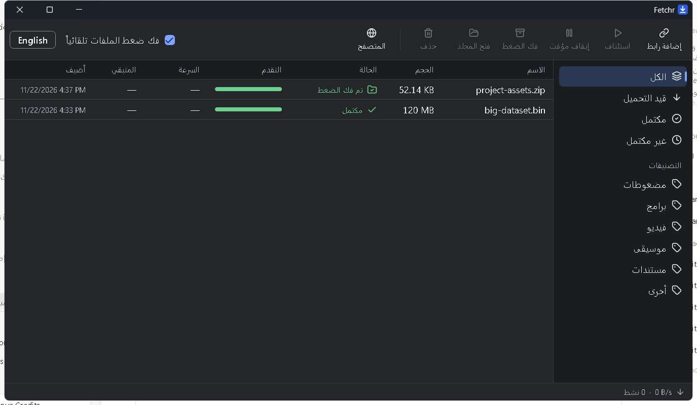
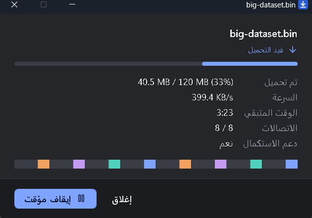

# Fetchr

مدير تحميلات مجاني لويندوز: تحميل متعدد الاتصالات يستكمل بعد إغلاق البرنامج، وفك ضغط تلقائي للأرشيفات عند اكتمالها. بدون ترخيص، بدون فترة تجريبية، وبدون حساب.

مكتوب من الصفر كبديل مفتوح المصدر لفكرة مدير التحميلات الشهير — لا كود منه، ولا أيقوناته، ولا شيء من ترخيصه.

[](https://github.com/essa808/fetchr/releases/latest)
[](https://github.com/essa808/fetchr/releases)
[](LICENSE)
[]()
[]()



## المزايا

- **8 اتصالات لكل ملف** (قابلة للضبط من زر **الإعدادات** في الشريط) مع إعادة تجزئة الأجزاء البطيئة تلقائياً: الاتصال الذي ينهي جزأه يأخذ ذيل الجزء الأبطأ بدل أن ينتظره، واستكمال من حيث توقف بعد إعادة تشغيل البرنامج.
- **إضافة رابط** يدوياً، أو **التقاطه من المتصفح** عبر إضافة Chrome/Edge.
- **إيقاف مؤقت / استكمال / إلغاء**، قائمة انتظار، تصنيف تلقائي حسب نوع الملف، بحث، وشريط حالة.
- **فك ضغط تلقائي** عند الاكتمال: zip بمحرك مدمج، و rar / 7z / tar.gz / iso / الأرشيفات المجزّأة عبر 7-Zip، مع كلمات المرور.
- نافذة تقدّم تفصيلية بأجزاء الاتصالات وسرعة لحظية ووقت متبقٍ:

  

- واجهة **عربية/إنجليزية**، فاتح/داكن، أيقونة في شريط المهام مع إشعارات.

## التنزيل

من صفحة [الإصدارات](https://github.com/essa808/fetchr/releases/latest): `Fetchr-Setup-0.3.0.exe`

- تثبيت لكل مستخدم بدون صلاحيات مدير، إلى `%LOCALAPPDATA%\Programs\Fetchr`.
- الحزمة مستقلة: لا تحتاج .NET ولا 7-Zip على جهازك.
- غير موقّع رقمياً، فيظهر تحذير SmartScreen أول مرة (More info → Run anyway).

## التشغيل من المصدر

يحتاج .NET 10 SDK:

```bash
dotnet build Fetchr.slnx
dotnet test tests/Fetchr.Core.Tests
dotnet run --project src/Fetchr.App
```

البيانات في `%LOCALAPPDATA%\Fetchr\fetchr.db`. للتجارب: `FETCHR_DB=<path>`، ولإجبار السمة: `FETCHR_THEME=light|dark`.

لتجربة التحميل بلا إنترنت، قدّم مجلداً يدعم Range وبسرعة محدودة:

```bash
python tools/devserver.py <folder> --port 8800 --kbps 600
```

## الإضافة (Chrome / Edge)

1. من البرنامج: **المتصفح → اتصال** (يكتب مفتاحاً في الريجستري للمتصفح أو المتصفحين، وملفاً في `%LOCALAPPDATA%\Fetchr\native-host`). زر **قطع** يزيلها فقط.
2. افتح `chrome://extensions` (أو `edge://extensions`)، فعّل وضع المطوّر، **Load unpacked**، واختر مجلد `extension`.

معرّف الإضافة مثبّت بمفتاحها العام، والخادم الأصلي يرفض أي متصل آخر. للاختبار بدون متصفح: `FETCHR_HOST_TEST=1`.

## بناء المثبّت

```bash
powershell -ExecutionPolicy Bypass -File installer\build.ps1 -Version 0.3.0
```

ينتج `out\Fetchr-Setup-<version>.exe` (يحتاج .NET 10 SDK وInno Setup 6 و7-Zip على جهاز البناء).

## الخصوصية

- لا حسابات ولا خادم ولا تتبعات؛ البرنامج لا يفتح أي منفذ شبكة. الإضافة تكلمه عبر **named pipe** خاص بالمستخدم الحالي فقط.
- كلمات مرور المواقع وكوكيز الالتقاط تُحفظ مشفّرة بـ DPAPI (نطاق المستخدم) وتُحذف عند اكتمال التحميل.
- سجل التحميلات محلي في SQLite تحت `%LOCALAPPDATA%\Fetchr`.

## البنية

- `src/Fetchr.Core` — المحرك: فحص الرابط، التحميل المجزّأ، قائمة الانتظار، SQLite، الأرشيفات و7-Zip، أسرار DPAPI، بروتوكول الـ pipe.
- `src/Fetchr.Host` — خادم native messaging الذي يشغّله المتصفح ويحوّل الطلبات إلى البرنامج.
- `src/Fetchr.App` — واجهة WPF؛ الألوان والمقاسات من `Themes/Tokens.*.xaml`، والأيقونات Lucide (ISC).
- `extension` — إضافة Manifest V3 (إنجليزي + عربي).
- `tests/Fetchr.Core.Tests` — اختبارات xUnit على خادم HTTP محلي يتعطّل عمداً.

## الترخيص

MIT — انظر [LICENSE](LICENSE). البرنامج يستخدم .NET/WPF، Microsoft.Data.Sqlite، Dapper، CommunityToolkit.Mvvm، Lucide، و7-Zip (LGPL): التفاصيل في [installer/THIRD-PARTY-NOTICES.txt](installer/THIRD-PARTY-NOTICES.txt).

---

### English

A free Windows download manager: multi-connection downloads that pause and resume across restarts, and archives that unpack themselves when they finish. No licence, no trial, no account. Download the installer from Releases; it is self-contained, per-user, and unsigned (SmartScreen warns once).

Build with the .NET 10 SDK: `dotnet build Fetchr.slnx`, `dotnet test tests/Fetchr.Core.Tests`, `dotnet run --project src/Fetchr.App`. Data lives in `%LOCALAPPDATA%\Fetchr\fetchr.db`; override with `FETCHR_DB`. The Chrome/Edge MV3 extension talks to the app over a current-user named pipe (no network port); secrets are DPAPI-protected. MIT licensed.
